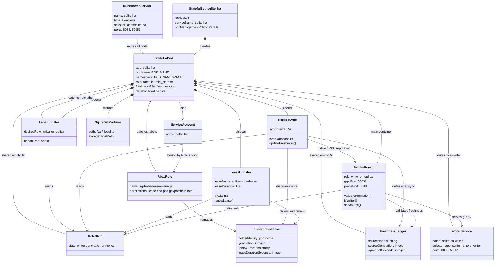
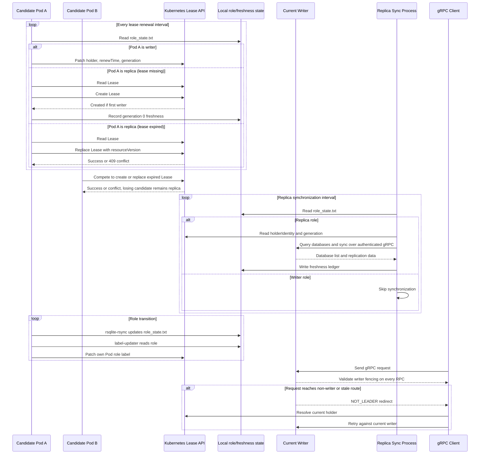
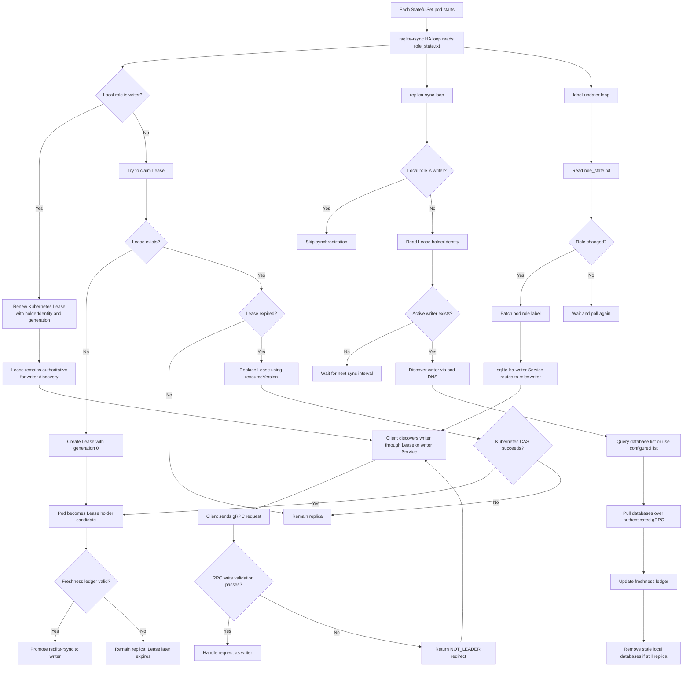

### Explanation

This Kubernetes manifest deploys a three-pod SQLite HA StatefulSet. It uses a Kubernetes Lease for writer election, shared files for role and freshness state, sidecars for lease management, replica synchronization, and writer-label updates, plus Services for general pod discovery and current-writer routing.

The ServiceAccount and RBAC resources allow the sidecars to manage the writer Lease and update pod labels. The `lease-updater.sh` sidecar renews the current writer's Lease or attempts to claim an expired Lease using Kubernetes optimistic concurrency. The main `rsqlite-rsync` process independently validates freshness and writer status, so Lease ownership and the `role=writer` label are routing mechanisms rather than the final write-safety authority.

Each replica periodically synchronizes databases from the active writer over authenticated gRPC and records freshness metadata. The headless `sqlite-ha` Service provides stable per-pod DNS for discovery, while `sqlite-ha-writer` routes to the pod currently labeled as the writer. Requests are still fenced at the RPC layer and can receive a `NOT_LEADER` response if routing is stale.

The manifest uses `hostPath` storage for SQLite data, `emptyDir` volumes for runtime state and logs, and probes on ports 8088 and 50051 for liveness, readiness, and gRPC traffic. The image and host data directory values are placeholders that must be substituted before deployment.

### Class diagram

### Sequence diagram

### Flow diagram

